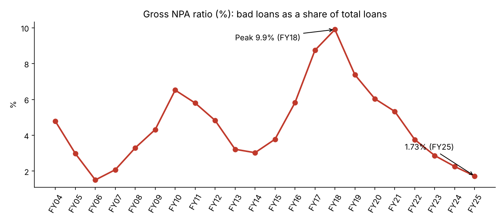
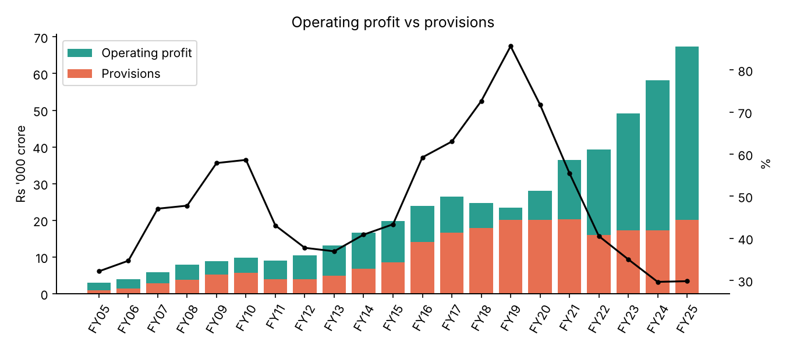

# ICICI Bank Historical Performance & Risk Analytics (FY2004–FY2025)

**Excel · SQL (PostgreSQL) · Tableau · Python (charts)**

An analysis of **21 years of Reserve Bank of India (RBI) data on ICICI Bank**, covering loans, bad loans (NPAs), profit, provisions, risk exposure, fraud and customer complaints. It tells the story of ICICI's bad-loan cycle: the GNPA ratio rose to **9.9% in FY18**, then was cleaned up to **1.73% in FY25**, while total loans grew **21×**.

🔗 **Live Tableau dashboard:** [ICICI Bank Performance & Risk (FY2004–FY2025)](https://public.tableau.com/views/ICICIBankperformanceandriskdashboard/ICICIBankPerformanceRiskFY2004-FY2025)
📊 **Excel workbook:** [`excel/ICICI_Bank_Analysis.xlsx`](ICICI-Bank-Project/excel/ICICI_Bank_Analysis.xlsx)
📝 **Insights:** [`docs/insights_report.md`](ICICI-Bank-Project/docs/insights_report.md)



---

## Business questions
1. How did ICICI's asset quality (bad loans) change over 21 years?
2. How fast did the loan book grow?
3. How much of the bank's operating profit was used up covering bad loans?
4. Was the bank adding bad loans faster than it was cleaning them up?
5. What happened to fraud and customer complaints?

## Data
- **Source:** Reserve Bank of India, *Year-wise Performance Statistics of ICICI Bank*, via [Dataful](https://dataful.in/dataset/23856).
- **212 rows, 14 metrics, 5 categories:** Credit Risk, Profitability, Risk Exposure, Operational Risk, Customer Service.
- **Units:** ₹ crore, %, or counts.

## Approach
1. **Cleaning (Excel / Python):**
   - The raw data mixes two year formats, `31-03-2025` (year-end balance) and `2024-25` (full-year total). Both are converted to one label (`FY25`).
   - Units are standardised ("crore" vs "crores").
   - The long table is pivoted into one row per year.
   - Missing years are left **blank, not zero**.
2. **Excel analysis:** the `4_Metrics` sheet calculates loan growth, provisions as a % of operating profit, NPA clean-up, net NPA addition and fraud per incident, using **live formulas**.
3. **SQL (PostgreSQL):**
   - A table and a yearly pivot view.
   - **10 business queries** using `RANK()`, `LAG()`, a 3-year moving average (window frame), `FILTER` aggregates and CAGR.
4. **Visualisation:** a Tableau dashboard, plus charts built in Python.

## Key insights
| # | Insight |
|---|---|
| 1 | **Bad-loan cycle:** the GNPA ratio went from 1.51% (FY06) to a **peak of 9.90% (FY18)**, then down to **1.73% (FY25)**. Gross NPAs fell **56%** from ₹53,240 cr to ₹23,523 cr. |
| 2 | **Strong growth:** gross advances grew from ₹63,823 cr to **₹13.6 lakh crore** (21.3×, a **15.7% CAGR**). |
| 3 | **Profit under stress:** in **FY19, provisions used up 85.7% of operating profit**. By FY25 this had fallen to **29.8%**, while operating profit reached **₹67,299 cr**. |
| 4 | **NPA build-up in FY17:** ₹25,969 cr of new NPAs, but only ₹15,912 cr recovered or written off. That was the worst year of the build-up, during the industry-wide corporate-loan crisis. |
| 5 | **Fraud spike in FY24:** ₹322.6 cr, versus under ₹10 cr in every earlier year in the data. Incidents rose to 6,588. |
| 6 | **Complaints peaked in COVID:** Ombudsman complaints reached **28,065 in FY21**, then fell to 16,602 by FY23. |



## Repository structure
All project files are inside the `ICICI-Bank-Project/` folder.
```
├── data/
│   ├── raw/        icici_rbi_raw.csv, metadata.csv
│   └── clean/      icici_clean_long.csv, icici_wide_with_metrics.csv (Tableau input)
├── excel/          ICICI_Bank_Analysis.xlsx (raw → clean → yearly → formulas → notes)
├── sql/            01_schema_and_load.sql, 02_analysis_queries.sql, 02_query_results.txt
├── scripts/        01_clean_data.py, 02_build_excel_and_charts.py
├── images/         6 charts
└── docs/           insights_report.md, interview_prep.md
```

## How to run
```bash
cd ICICI-Bank-Project/scripts && python 01_clean_data.py && python 02_build_excel_and_charts.py && cd ..
createdb icici
psql -d icici -f sql/01_schema_and_load.sql
psql -d icici -f sql/02_analysis_queries.sql
```

## Data notes and limitations
- Fraud data covers only FY18–FY24 (FY23 missing), complaints FY14–FY23, and NPA flows FY15–FY25.
- Gross advances drop sharply in FY10 and contingent liabilities spike in FY08. Both are flagged to verify against annual reports.
- Gross NPA can fall even when new NPAs exceed recoveries plus write-offs, because **upgrades** (loans becoming regular again) aren't in this dataset.

## Author
**Soham Ghosh**, B.E. Printing & Packaging Engineering, Jadavpur University
[LinkedIn](https://www.linkedin.com/in/soham-ghosh-846546282/) · [GitHub](https://github.com/Soham29Ghosh)
